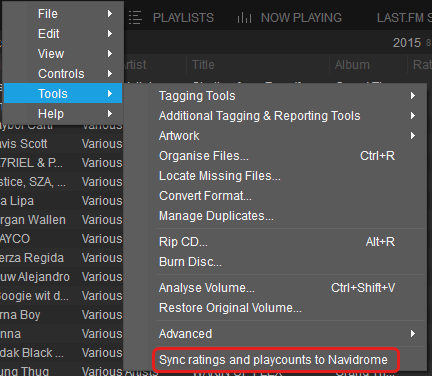
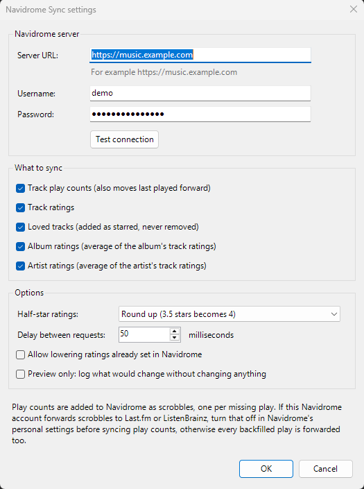

# Navidrome Sync for MusicBee

A MusicBee plugin that pushes your play counts, ratings and loved tracks to a [Navidrome](https://www.navidrome.org/) server with one click, from **Tools → Sync ratings and playcounts to Navidrome**.

It talks to Navidrome through its standard Subsonic API, so it needs nothing more than your server URL, username and password. There is no database copying, no CSV exports and no need to stop Navidrome.

## What it syncs

The sync is one way, from MusicBee to Navidrome. Each item can be switched on or off in the settings:

- **Track play counts**, which also move Navidrome's last played date forward
- **Track ratings**
- **Loved tracks**, which become starred tracks in Navidrome
- **Album ratings**, calculated from the album's track ratings
- **Artist ratings**, calculated from the artist's track ratings

## How it decides what to change

The plugin only ever applies changes that are more favourable than what Navidrome already has, so running it repeatedly is safe.

- **Ratings** are only raised, never lowered, unless "Allow lowering ratings" is ticked. An unrated MusicBee track never clears a rating set in Navidrome.
- **Half-star ratings** are rounded to whole stars, because Navidrome only stores whole stars. Rounding up is the default (3.5 becomes 4), and this can be changed in the settings.
- **Loved tracks** are only ever starred, never unstarred, so anything you starred from another Navidrome client stays starred.
- **Play counts** are only increased. If MusicBee has 40 plays and Navidrome has 10, the plugin adds the missing 30. If Navidrome already has more plays than MusicBee, nothing changes.
- **Album ratings** are set to the average of the album's track ratings, once more than half of its tracks are rated.
- **Artist ratings** work the same way, for artists with more than one track.
- **Album and artist play counts** need no work from the plugin, because Navidrome calculates them from track plays itself.

## Limitations

These come from what the Subsonic API allows.

- **Play counts can only go up.** The API has no way to set a play count directly. Missing plays are added as scrobbles, one per play, sent in batches of 50.
- **The first sync can take a while.** A large library with years of plays may need thousands of scrobbles. Later syncs only send plays made since the last sync.
- **Last played only moves when plays are added.** Each added play is stamped with MusicBee's last played date. Navidrome keeps whichever date is newest, so this can never move its last played date backwards. If the play counts already match, a newer MusicBee last played date cannot be sent on its own.
- **Tracks are matched by file path or by tags.** Path matching needs Navidrome to report real file paths, which is off by default. Without it, tracks are matched on title, album and artist, using track number, disc number and duration to tell apart songs with the same name. Anything that can't be matched with confidence is skipped and listed in the log rather than guessed.
- **It syncs to the account you log in with.** The Subsonic API always acts as the logged-in user.

## Requirements

- MusicBee 3.5 or later
- Windows with .NET Framework 4.8, which is included with current versions of Windows 10 and 11
- A Navidrome server and an account on it

## Installation

1. Download the release zip and extract it.

2. If Windows has marked the downloaded file as blocked, unblock it. Either right-click `mb_NavidromeSync.dll`, choose **Properties** and tick **Unblock**, or run this in PowerShell from the folder you extracted to:

   ```powershell
   Unblock-File .\mb_NavidromeSync.dll
   ```

3. Close MusicBee.

4. Copy `mb_NavidromeSync.dll` into MusicBee's `Plugins` folder. Where that is depends on how MusicBee was installed:

   - **Standard installation:** `C:\Program Files (x86)\MusicBee\Plugins`
   - **Microsoft Store version:** `%APPDATA%\MusicBee\Plugins`
   - **Portable installation:** the `Plugins` folder inside your MusicBee folder

   For a standard installation, this PowerShell command copies it into place. Run it from the folder you extracted to, in a PowerShell window opened as administrator:

   ```powershell
   Copy-Item .\mb_NavidromeSync.dll "C:\Program Files (x86)\MusicBee\Plugins\"
   ```

   Alternatively, while MusicBee is running, go to **Edit → Edit Preferences → Plugins**, click **Add Plugin** and choose the dll. MusicBee copies it to the right place for you.

5. Start MusicBee and open **Edit → Edit Preferences → Plugins**. Find **Navidrome Sync** in the list and make sure it's enabled.

6. Click **Configure** next to Navidrome Sync and fill in:

   - your Navidrome URL, for example `https://music.example.com`
   - your username
   - your password

   Click **Test connection** to check the details, then **OK**.

7. The sync is now available from **Tools → Sync ratings and playcounts to Navidrome**. In MusicBee's default layout, click the **MusicBee** menu at the top left to reach the Tools menu.

   

## Before your first sync

**Turn off scrobble forwarding.** If your Navidrome account forwards scrobbles to Last.fm or ListenBrainz, turn that off in Navidrome's personal settings before syncing play counts. Otherwise every backfilled play is forwarded as well. You can turn it back on once the first sync has finished.

**Run a preview first.** Tick **Preview only** in the settings and run the sync. Nothing on the server is touched, and every change that would be made is written to the log. When the log looks right, untick **Preview only** and run it for real.

## Settings



| Setting | What it does |
| --- | --- |
| Server URL, Username, Password | Your Navidrome login. The password is encrypted with Windows' built-in data protection and can only be read by your Windows account. |
| What to sync | Choose which of the five items above are synced. |
| Half-star ratings | Round up (default), round down, or round to nearest. For track ratings, round to nearest behaves like round up, because a half star sits exactly between two whole stars. It makes a difference for album and artist averages. |
| Delay between requests | Pause between requests to the server, in milliseconds. The default of 50 keeps a large first sync from hammering the server. |
| Allow lowering ratings | Lets a lower MusicBee rating replace a higher one in Navidrome. |
| Preview only | Writes what would change to the log without changing anything. |

To bind the sync to a keyboard shortcut, look for **Navidrome Sync: sync ratings and playcounts to Navidrome** in MusicBee's hotkey preferences.

## The log

Every run writes a log with a summary, each change made, any problems, and every track that couldn't be matched. Click **Open log** when a sync finishes, or find it in MusicBee's settings folder:

- **Standard installation:** `%APPDATA%\MusicBee\NavidromeSync\last-sync.log`
- **Portable installation:** under the `AppData` folder inside your MusicBee folder

Each run replaces the previous log. The plugin's settings file, `settings.xml`, is kept in the same folder.

## Building from source

Building needs the [.NET SDK](https://dotnet.microsoft.com/download) (version 6 or later) on Windows. Run this from the project folder:

```powershell
dotnet build -c Release
```

The plugin is written to `bin\Release\net48\mb_NavidromeSync.dll`. MusicBee only loads plugin files whose names start with `mb_`, so keep that name.

`src\MusicBeeInterface.cs` is MusicBee's own plugin API definition from the MusicBee plugin SDK, included unchanged.

## Credits

Inspired by [MusicBee to Navidrome Sync](https://github.com/rombat/musicbee-navidrome-sync) by rombat. Its approach to syncing is the basis for the rules this plugin follows: favourable-only updates, and album and artist ratings from track averages.

## Licence

Released under the GNU General Public Licence v3.0. See [LICENCE](LICENCE).
